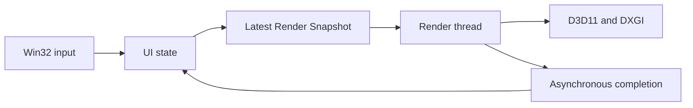

[English](architecture.md) | [简体中文](../zh-CN/architecture.md)

<!-- doc-id: architecture; revision: 2; status: implementation-review -->

# Architecture scope and Stage A review

Pixstride targets Windows 10/11 x64 with Rust Stable, Win32/windows-rs, D3D11, and DXGI Flip Model
presentation. Stage A now has a local implementation. The later image-decoding, navigation, and cache
designs remain proposals; this page does not reproduce the early internal design drafts.

## Stage A implementation

The UI thread owns the `HWND`, message loop, input, and current view state. A dedicated render thread
creates and owns the D3D11 Device, Immediate Context, DXGI Swap Chain, shaders, and textures. This keeps
D3D11 COM interfaces on one thread and moves device work and `Present` out of the message procedure.
The thread model is not a performance conclusion until interactive latency measurements are available.

`Arc<Shared>` holds one `Mutex<PendingState>` containing the latest Render Snapshot, a redraw flag, and
a shutdown flag. The UI overwrites this state and signals an auto-reset event; it does not enqueue each
input as a render job. The renderer waits for work and, while a frame is pending, the DXGI frame-latency
handle. When no redraw is pending it waits only for work, so idle rendering does not poll. No COM
interface crosses the thread boundary. The UI keeps pumping messages during resize and shutdown and
does not join the render thread from a window procedure.

The window procedure stores a stable `Box<WindowContext>` pointer in `GWLP_USERDATA` during
`WM_NCCREATE` and clears it during `WM_NCDESTROY`. The UI retains the `HWND` until the render thread
releases its D3D11 resources and posts `WM_RENDER_STOPPED`. The UI then destroys the window. Resize
and `ResizeBuffers` run on the render thread; before `ResizeBuffers`, it clears the Immediate Context
and releases the old Back Buffer view. Zero-sized minimized surfaces suspend drawing.

The renderer tries a hardware device at Feature Level 11.1 or 11.0, then tries WARP if device creation
fails. It uses a two-buffer Flip Discard Swap Chain, a frame-latency waitable object with maximum
latency 1, and `Present(1, 0)`. The program creates two 256 × 256 RGBA8 test textures at startup and
uses Left/Right to select their existing Shader Resource Views. `build.rs` compiles HLSL with the
Windows SDK `fxc.exe` and embeds DXBC into the executable.

On a failed `Present`, the renderer reads `GetDeviceRemovedReason`, reports the failure, releases its
resources, and exits. Stage A does not recreate a removed device. Rust COM wrappers provide reference
count management; they do not guarantee apartment, buffer, or lifetime preconditions. No COM object
is shared with the UI thread, and this code does not justify arbitrary `unsafe impl Send`.

| Stage A validation | Current evidence and remaining work |
|---|---|
| Input latency | Timing points exist for input handling, publication-to-render-thread consumption, command preparation, and `Present`. Interactive samples and a displayed-frame observation are still needed. |
| Thread wakeup cost | The latest snapshot and event coalesce queued state. P50/P95/P99 and a comparison with rendering on the UI thread have not been collected. |
| Resize | Resize is coalesced, zero sizes skip rendering, and the old Render Target is released before `ResizeBuffers`. Repeated interactive resize and DPI movement remain unverified. |
| Shutdown | `WM_CLOSE` requests asynchronous shutdown; the UI waits for `WM_RENDER_STOPPED` before destroying the window. Interactive close/race testing remains outstanding. |
| Device Removed | A failed `Present` queries `GetDeviceRemovedReason` and exits safely. Device recreation and injected removal tests are deferred. |
| Resource synchronization | The Immediate Context and Swap Chain stay on the render thread. No image cache or resource reuse pool exists in Stage A. |

The [D3D11 thread rules](https://learn.microsoft.com/en-us/windows/win32/direct3d11/overviews-direct3d-11-render-multi-thread-intro)
and [Present contract](https://learn.microsoft.com/en-us/windows/win32/api/dxgi/nf-dxgi-idxgiswapchain-present)
constrain the implementation. Rust COM wrappers manage reference counts; they do not prove apartment,
buffer, or lifetime preconditions. UI COM services use STA; decoder COM objects later stay with their
MTA workers unless explicitly marshalled. No arbitrary `unsafe impl Send` is justified by this design.

The implementation uses a two-buffer Flip Discard Swap Chain, maximum frame latency 1, and on-demand
rendering. It waits for frame readiness before drawing, including the first frame. Idle rendering
waits for work rather than polling an already-signalled frame handle. These settings follow the
[Flip Model guidance](https://learn.microsoft.com/en-us/windows/win32/direct3ddxgi/for-best-performance--use-dxgi-flip-model)
and [waitable-object contract](https://learn.microsoft.com/en-us/windows/win32/api/dxgi1_3/nf-dxgi1_3-idxgiswapchain2-getframelatencywaitableobject);
their latency benefit must be measured on an interactive target system.

## Keep the first implementation small

| Stage | Implement when that stage is approved | Reserve or defer |
|---|---|---|
| A | Win32 lifecycle, one render owner, latest snapshot, simple sequence/Device Epoch if needed, embedded test texture, QPC events, resize/shutdown/recovery tests. | No file navigation, decoder pool, CPU/GPU image cache, IPC, Job Object, Color Cache, or Tile scheduler. |
| B | WIC ordinary-image evaluation, pixel/stride contract, source validity, bounded decoding, CPU/GPU cache, navigation and stale-result rejection. | Start with simple bounded queues and an in-flight map; defer a general priority framework and pooled Texture allocator until measured. |
| C | Sequential large-PNG prototype, preview, disk Tile Cache, Tile Pyramid, visible-region rendering and resource-failure tests. | Evaluate worker IPC and Job Object isolation after the row-decoding and cancellation prototype; no stable plugin or IPC ABI yet. |
| D | Per-format capabilities, animation, basic ICC, configurable input and comic reading. | Add Color Key/derived caches only with a tested color path; HDR and complex filters remain later proposals. |

Interfaces reserved for B/C describe pixel layout, cancellation, budget failure, and decoder capabilities.
They do not require empty runtime services or a network of counters in A. Each later Generation must
have one owner and a distinct invalidation reason before it is added.

## Ordinary and large images

Ordinary images should use file read → decode → GPU upload → display. For the same validated
Image Key and Device Epoch, a GPU cache hit reuses the Texture without reading the source again,
decoding, scanning the directory, or uploading pixels. File/colour-policy changes are real invalidation
events; weak size/time metadata alone cannot guarantee immutable contents.

Large PNGs need a separate path. Their concatenated IDAT payloads form a continuous compressed
stream; arbitrary rectangles cannot be located by an independent file offset. A proposed builder
reads rows, creates lower resolutions, and writes independently readable disk Tiles. A complete first
preview may require scanning the entire image stream. See the
[PNG specification](https://www.w3.org/TR/png-3/) and [stress test plan](stress-testing.md).

The initial candidate is a 1024-pixel logical Tile with a 512 MiB builder allocation budget.
Compare 512, 1024, and 2048 Tiles. A 640 MiB worker-process limit is a separate proposal, not a measured
working-set bound. Job Object limits provide resource/failure isolation, not a complete security sandbox.
None of these values has been established as optimal.

D3D11 Feature Level 11.x limits a Texture2D side to 16384 pixels. This is a GPU resource limit,
not a file-format or decoder limit, and smaller allocations can still fail.
[D3D11 resource limits](https://learn.microsoft.com/en-us/windows/desktop/direct3d11/overviews-direct3d-11-resources-limits)
support this boundary. Use checked 64-bit size calculations, independent CPU/GPU/disk reservations,
and coarse previews or explicit errors when resources are insufficient. Do not allocate a full huge bitmap
as an unnoticed fallback. Preserve premultiplied-alpha and color-domain semantics across paths.

## Review action register

| ID | Risk or correction | Owner and gate |
|---|---|---|
| A-01 | Render-thread wakeups could worsen tail latency. Keep the model revisable. | Rendering; stage A timing report. |
| A-02 | Resize/shutdown can deadlock with DXGI or retain back-buffer references. | UI/Rendering; stress, debug-layer and lifecycle tests. |
| A-03 | A frame-latency signal is not a GPU resource-completion fence. | Rendering; explicit in-flight/reuse tests. |
| B-01 | WIC may allocate internally or fail to cancel inside one call. | Decoder; per-codec peak/cancellation data and conservative routing. |
| B-02 | Stale completions or file replacement can select the wrong pixels. | Core/Cache; reverse navigation, source changes, and key tests. |
| C-01 | The 512 MiB estimate excludes unknown decoder/allocator overhead. | Large-image prototype; allocation, process, and OS-cache measurements. |
| C-02 | Tile writes, cache validity, and filtering borders add complexity. | Disk Cache/Rendering; small oracle fixtures before the private sample. |
| C-03 | IPC/Job Object adds startup and recovery cost. | Large-image prototype; justify isolation with cancellation/failure evidence. |
| D-01 | A derived Color Cache may repeat conversions or conflict with OS color management. | Color path; keep deferred until profile/ACM tests exist. |

The original designs and raw environment evidence are retained privately, unchanged. Their detailed
budgets and mechanisms remain proposals. A prior environment probe compiled and created a WIC Factory
and a D3D11 hardware device; it did not test a Swap Chain, viewer, or product latency.
The debug device returned `0x887A002D`; obtain authorization for Graphics Tools installation before
claiming debug-layer validation. No product performance result is available.
