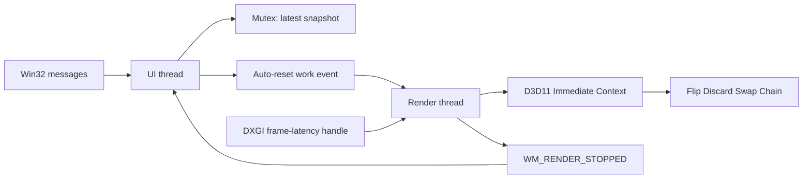

[English](stage-a.md) | [简体中文](../zh-CN/stage-a.md)

<!-- doc-id: stage-a; revision: 5; status: implementation-review -->

# Stage A: Win32 window and D3D11 rendering

Stage A is the first runnable Pixstride application slice. It checks whether a native Win32 window,
a dedicated D3D11 render thread, and an on-demand DXGI presentation path fit the project. It does not
load image files or implement viewer navigation.

## Runtime ownership and event flow

The UI thread creates and owns the `HWND`, handles the Win32 message loop, updates the latest render
state, and signals a Windows auto-reset event. The render thread creates and owns the D3D11 Device,
Immediate Context, Swap Chain, shaders, render target, sampler, and two test textures. No D3D11 COM
interface crosses the thread boundary. The UI keeps the `HWND` alive until the render thread releases
its resources and posts `WM_RENDER_STOPPED`.



`Arc<Shared>` shares a small `Mutex<PendingState>` between the two threads. The state contains the
current test texture, client size, sequence number, redraw flag, and shutdown flag. Updates replace
the snapshot instead of appending render jobs, so a burst of navigation input cannot create an
unbounded queue. The auto-reset event wakes the renderer; it is not the state store. While a frame is
pending, the render thread waits for either work or DXGI's frame-latency handle. When no frame is
pending, it waits only for work and does not poll.

The window procedure reads a stable `Box<WindowContext>` pointer from `GWLP_USERDATA`. The UI thread
installs it during `WM_NCCREATE` and clears it in `WM_NCDESTROY`. On close, the UI requests shutdown
and keeps dispatching messages. The render thread clears the Immediate Context, releases the Back
Buffer view and other COM wrappers, then posts `WM_RENDER_STOPPED`; only then does the UI destroy the
window. `ResizeBuffers` also runs only on the render thread, after clearing context bindings and
dropping the previous Render Target View. A zero-sized minimized client area suspends rendering.

## D3D11 and presentation path

The renderer first requests a hardware D3D11 device at Feature Level 11.1 or 11.0. It tries WARP if
device creation fails. The fallback does not retry a later Swap Chain or shader failure. The current
code creates a two-buffer `DXGI_SWAP_EFFECT_FLIP_DISCARD` Swap Chain with
`DXGI_SWAP_CHAIN_FLAG_FRAME_LATENCY_WAITABLE_OBJECT`, sets maximum frame latency to 1, waits for the
frame-latency object before drawing, and calls `Present(1, 0)`.

At startup, the program generates two 256 × 256 RGBA8 test images in memory: a checkerboard and a
gradient. It creates one D3D11 Texture2D and Shader Resource View for each. Left and Right select the
existing view; they do not regenerate or upload the pixels. A full-screen triangle samples the
selected texture with a linear sampler. The window stretches the test pattern to its client area.

`build.rs` compiles `shaders/test_pattern.hlsl` with the Windows SDK `fxc.exe` into the Cargo `OUT_DIR`.
The executable embeds the resulting DXBC bytecode; the program does not compile shaders during normal
startup or on a frame. Set `PIXSTRIDE_FXC` to the full `fxc.exe` path when automatic Windows SDK
discovery does not find the compiler.

The renderer checks failed `Present` calls and queries `GetDeviceRemovedReason`. It reports the error
and exits; device recreation and recovery are not implemented in Stage A. Rust COM wrappers release
their references when the renderer is dropped on its owner thread. The UI thread does not own a D3D11
resource.

## Timing and measurement boundaries

The program uses `std::time::Instant`, which is monotonic on Windows and is backed by the system's
high-resolution clock. It stores up to 4096 recent samples per metric in a fixed-capacity ring and
prints count, minimum, maximum, P50, P95, and P99 after shutdown. Percentiles use nearest-rank
selection. It does not synchronously write a log for each frame.

| Metric | Measured interval |
|---|---|
| Startup | Process entry to return from `CreateWindowExW`; not first visible or composed frame. |
| D3D11 initialization | Device, Swap Chain, compiled shader creation, test texture upload, and initial Render Target setup. |
| Input handling | Direction-key handling through latest-state publication and event signal. |
| Request to render thread | Snapshot publication timestamp to the render thread consuming that snapshot. |
| Render commands | CPU time for setting D3D11 state, clearing the target, and issuing the triangle draw. |
| Present | Time spent inside `Present(1, 0)`. This is not display time. |
| Resize | CPU time for the render-thread resize and Render Target recreation; zero-size suspension is excluded. |
| Shutdown | UI close request to render-thread exit. It does not include all OS process teardown. |

The Stage A metrics do not prove when a frame reaches the monitor. Use PresentMon/ETW to observe
displayed-frame events, and an external high-speed capture method for Input-to-Photon measurements.
Neither method is part of the current application. Do not interpret a quick `Present` return as a
display-latency result.

Two local Release launches recorded 2.824 ms and 4.762 ms from process entry to the return of
`CreateWindowExW`, and 223.234 ms and 206.379 ms for D3D11 initialization. These are two diagnostic
samples on one machine, not controlled cold/hot-start measurements or a reliable percentile report.
Both runs logged that the first `Present` call returned successfully. The logs did not record whether
the hardware driver or WARP created the device.

## Build and run

Use Windows 10/11 x64 with Rust Stable, the `x86_64-pc-windows-msvc` target, MSVC C++ Build Tools,
the Windows SDK, and `fxc.exe`.

```powershell
cargo fmt --all -- --check
cargo clippy --all-targets --locked -- -D warnings
cargo test --locked
cargo build --release --locked
cargo run --release
```

The Release executable is `target/release/pixstride.exe`. Closing it prints the accumulated timing
summary to stdout. The Rust CI workflow runs formatting, Clippy, tests, Release build, and Rustdoc on
`windows-latest`. It does not run interactive GUI tests or set the GitHub Ruleset's required checks.

## Verification status

Local Rust validation passed: formatting, Clippy with warnings denied, seven unit tests, Release build,
and Rustdoc generation. The unit tests cover the bounded timing sample window, percentile calculation,
generated texture data, latest-state coalescing, and terminal shutdown state.

A local executable launch created a Win32 window that `IsWindowVisible` reported as visible and logged
D3D11 device creation at Feature Level 11.1 (`0xB100`). The current automation environment did not
expose the native window for visual inspection, so visible texture content,
keyboard switching, interactive resize/minimize/restore, normal close, repeated launch/close, and input
timing distributions remain unverified. The Rust CI
workflow has been added locally but has not run on GitHub because this branch has not been pushed.

The thread model is therefore an implementation under review, not a measured latency decision. Stage A
must still collect wake-to-render and Present samples on an interactive Windows desktop and compare
the result with the 50 ms startup, 5 ms cached-switch handling, and 1 ms input-processing engineering
targets. Those numbers remain targets, not results.
