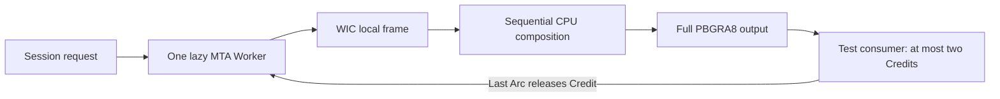

[English](stage-d1b1.md) | [简体中文](../zh-CN/stage-d1b1.md)

<!-- doc-id: animation-worker; revision: 3; status: merged-history -->

# D1-b1: background GIF frame production

This page records the merged D1-b1 scope and its original measurements. The current local
[D1-b2 branch](stage-d1b2.md) adds Renderer consumption and transfers the controller to that thread;
the no-playback statements below describe the D1-b1 milestone, not the current branch.

This branch adds a testable animation backend. The Viewer still displays the static GIF poster from
[D1-a](stage-d1a.md). It does not play animations, create animation GPU resources, change input
bindings, or schedule Present deadlines. No new dependency was added.

## Ownership and consumer contract

`ImageLoader` owns one `AnimationWorker` controller. Construction creates no animation thread or
events; the first `start(Request)` creates one reusable MTA thread. The existing static WIC Worker,
source-validation thread, GPU-cache fast path, render thread, and Tile Worker keep their roles.
Starting a replacement session never creates a substitute thread for a blocked WIC call.



WIC factory, decoder, frame and converter objects are created, used and released on that MTA thread.
The decoder is deliberately not `Send`. The worker owns the composition canvas and saved region.
Consumers receive `Arc<FrameOutput>` with owned pixels and immutable metadata; no COM or `HWND`
crosses this interface.

| Identifier | Owner and lifetime |
|---|---|
| Selection Generation | Existing file-selection state; animation frames do not advance it. |
| Session ID | Controller-local monotonically increasing ID; changes on every `start`. A session key contains both identifiers. |
| Frame Ordinal | Producer; increases across requested passes within one session. Frame index and pass are also carried. |
| Source Revision | Validated path, length, modification time and `ImageContent::GifAnimationV1`; distinct from `GifPosterV1`. |
| Credit | One output permit; held from before decoding through the last reference to its output. |

`start` only publishes a path and request; it performs no file I/O on the caller. A request explicitly
chooses a number of scan passes (or production until cancellation) and Disposal 2 background behavior.
Neither choice is a Viewer playback default. Raw `delay_cs` remains in hundredths of a second;
`raw_loop: Option<u16>` distinguishes missing, zero and positive values. No delay clamp, loop-count
interpretation or real playback clock is applied. Metadata types follow the
[WIC GIF metadata queries](https://learn.microsoft.com/en-us/windows/desktop/wic/-wic-native-image-format-metadata-queries).

Consumers wait for the borrowed ready event and call `poll(session)` to atomically obtain state and at
most one frame. They must keep the controller alive while waiting and never close its event handles.
`poll` rejects another session's queued output. A consumer retaining an older `Arc` must call
`is_current` before submission; cancellation, replacement and failure invalidate it. D1-b2 still needs
to coordinate this check with the render selection and GPU submission boundary.

`Starting` becomes `Running`, acknowledged `Paused`, `Completed` or `Failed`. Cancel invalidates the
target immediately; the worker cleans up before acknowledging `Idle`. Shutdown ends in `Stopped` or
fatal `Failed`. `Completed` describes production, not consumer release. The done event signals exit
of the reusable thread, not completion of one session. No polling loop is used while idle, paused or
waiting for a Credit.

## Composition and admission

The existing bounded GIF parser is reused: 64 MiB file/scan admission, 8 KiB reads, bounded metadata,
mandatory Trailer and bounded zero padding. It still does not validate LZW contents. The animation
mode additionally collects maximum patch/restore sizes and raw Loop metadata in fixed-size storage.
Duplicate recognized Loop extensions or malformed recognized Loop payloads are rejected as ambiguous;
the poster path keeps its previous bounded-skip behavior.

The canvas starts transparent on each pass. Each frame first applies the preceding Disposal:
0/1 keeps the canvas, 2 restores the preceding rectangle, and 3 restores its saved pre-paint region.
The current Disposal 3 region is saved before drawing. Transparent indices retain existing pixels;
opaque palette entries replace them. The output is a complete, tightly packed PBGRA8 Logical Screen,
not the local rectangle. Every composition step runs even if a consumer discards an output.
These operations follow the [GIF89a specification](https://www.w3.org/Graphics/GIF/spec-gif89a.txt).

Disposal 2 explicitly accepts transparent clearing or a valid Logical Screen global background color
(transparent fallback if absent). Both are fixture-tested; no final animation default is selected.
The Logical Screen background, transparent index and Viewer checkerboard are separate concepts.
The D1-a poster retains its transparent initial canvas.

## Shared pixel budget and backpressure

The ordinary CPU total remains 512 MiB, with an animation subquota of 256 MiB **inside** that total.
Ordinary single-image admission remains 256 MiB; ordinary GPU residency remains 512 MiB. Stage C's
separate budgets and disk format are unchanged. No animation GPU allocation or 128 MiB GPU subquota
is instantiated in D1-b1.

`CpuMemory` reservations follow each owned pixel `Vec` capacity. Static cache entries and animation
buffers share the same ledger. Cache eviction removes membership but does not return the charge
while a renderer/result `Arc` still owns those pixels. Arc clones neither double-charge nor return
bytes early. Charge fields follow pixel fields so allocation release precedes quota return.

Let `C` be full canvas bytes, `P` the largest local patch and `R` the largest Disposal 3 saved region.
Admission checks `3C + P + R`: one canvas, two complete outputs, one patch and one saved region.
Checked arithmetic rejects oversized layouts. Every subsequent allocation also reserves against both
the shared total and animation subquota; old sessions' retained frames remain charged. Allocation or
quota failure becomes a session error. The poster remains the Viewer behavior. There is no automatic
cross-worker cache eviction or retry loop to force an animation to fit.

At most two output Credits exist across queued, consumer-held, cloned and in-production outputs.
Credit acquisition precedes decode. When both are held, the producer waits on a condition variable;
pause, cancel, replacement and shutdown wake it. Old queued buffers are retired by the worker outside
the control mutex; the caller does not free large queued pixels synchronously. With two old externally
held outputs, a new session may have to wait for their release or fail memory admission.

The ledger bounds application-owned pixel capacity, not process memory. WIC internal allocations,
allocator bookkeeping, stacks, parser/control metadata and bounded diagnostic samples are outside it.
The WIC/driver/OS process is not hard-isolated.

## Cancellation and shutdown boundaries

Pause is cooperative: a synchronous call may finish before the worker acknowledges `Paused`; no new
output is published after that acknowledgement until resume. Cancellation is checked between WIC
calls and composition rows. An in-flight WIC call cannot safely be interrupted.

`shutdown` invalidates output and wakes all application waits without blocking the caller. The worker
releases its COM objects and canvas, drains queued output outside the mutex and signals done.
`try_join` only joins an already-finished thread. If controller destruction occurs during a blocked
WIC call, at most this one thread is detached; its owned `Arc`s retain the events, ledger and data,
and it has no UI/window reference. There is no fixed exit deadline and no replacement thread.
D1-b2 must keep UI messages flowing, wait for done asynchronously, and then join. External output
references can outlive worker exit and remain charged until their final release.

## Verification on Windows

The local default suite passes 87 tests; 26 opt-in probes are ignored by that default run. Animation
tests use manually specified expected pixels, independent of the compositor: 80 outputs / 960 pixel
positions cover Disposal 0–3, local palettes, transparency, two passes and four raw Loop variants.
Additional cases cover GIF87a without GCE, first-frame offsets, background alternatives, delay 65535,
invalid input, revision changes, budget pressure, last-Arc release, two exhausted Credits, pause,
replacement, initialization failure, gated cancellation and repeated sessions. Default-budget tests
reserve quota without allocating hundreds of MiB; Release probes below allocate actual buffers.

Thirteen Release diagnostic groups passed: fixture preparation; five animation workloads; cancellation;
GIF poster GPU readback; poster Viewer; hold/reverse navigation; ordinary navigation/cache; synthetic
large-PNG Viewer; Tile GPU readback. Existing static GPU texture reuse passed; Tile readback checked
17,425 pixels including edges. The large-image regression uses a generated 20000 × 65 PNG and a
dedicated test cache. No private extreme image or its cache was accessed. Window probes exercise
Win32 APIs; this is not a new human visual acceptance or animation playback test.

### Initial CI failure and deterministic repair

The [initial Rust run](https://github.com/pachi-qwq/pixstride/actions/runs/39782121631) on
`4631d82a5db95c16fea07cc3f80f3b60d38419c5` passed 85 tests and failed
`animation_failure_discards_queued_frames_and_invalidates_held_output`. After five seconds its snapshot
was Running, with three outputs produced, two outstanding Credits and one queued frame. Other WIC
tests passed. The runner used Windows Server 2025 / Rust 1.99.1; local tests used Windows / Rust 1.96.0.
The log provides no evidence that COM initialization, fixture collisions or the Node.js warning caused
this failure.

The test sampled remaining quota after receiving two outputs. Publishing an output does not imply
the worker has destroyed its local patch. A deterministic allocation test shows that releasing a
16-byte second patch and a 48-byte output after that snapshot leaves enough space for the next
8-byte patch and 48-byte output. Waiting for Failed was therefore not guaranteed. This ordering is
consistent with the CI snapshot; the log does not trace the exact instruction schedule.

The repaired test uses existing post-CopyPixels gates to hold the second frame before composition,
then fills the quota while pixel ownership is stable. It separately checks a queued first output and
a consumer-held first output. It waits for failure plus the expected Credit count, since queue
destruction happens outside the control mutex. The failure reason, stale-output rejection and final
byte/Credit release are asserted. No production code, timeout, global budget or workflow was changed.
The repaired target passed 512 repetitions across eight concurrent processes; 32 complete suites,
each with 16 test threads and up to four concurrent processes, also passed. The original target had
passed 128 local repetitions, illustrating why a passing stress run alone cannot establish ordering.

### Measured animation workload

Release x64, Rust 1.96.0, windows-rs 0.62.2, system WIC, one fresh test process per workload on
2026-10-22. Fixture preparation runs separately; OS file caches are not cleared. Every workload
deliberately stops consumption for 40 ms. The slow consumer then waits 2 ms per output. Values below
are application-side microseconds; each percentile triple is P50/P95/P99.

| Workload | Outputs | Init (one sample) | WIC local decode | CPU composition | Full output preparation | Charged pixel peak (bytes) |
|---|---|---|---|---|---|---|
| 4 × 3 deterministic | 5 | 4604 | 43/96/96 | 0/0/0 | 0/0/0 | 160 |
| 512 × 256 fast consumer | 128 | 16964 | 693/943/1035 | 57/125/143 | 66/90/154 | 2,097,152 |
| 512 × 256 slow consumer | 128 | 17211 | 690/1005/1143 | 76/130/196 | 67/95/181 | 2,621,440 |
| 2048 × 1024 large canvas | 4 | 9882 | 10013/10573/10573 | 789/2000/2000 | 1074/1083/1083 | 33,554,432 |
| 512 × 512, 64 × 64 patches | 128 | 5990 | 64/101/129 | 2/9/14 | 156/181/206 | 3,178,496 |

Decode includes local allocation, metadata/converter calls and CopyPixels. Composition includes
Disposal and saved-region work. Output preparation includes allocation and canvas copy, excluding
Credit/pause waiting. Zero means below integer-microsecond resolution. Four/five-frame percentile
tails are maxima, not stable population estimates. These fixtures do not predict all real GIFs.

| Workload | Process peak Working Set (bytes) | Maximum sampled Private Usage (bytes) | Shutdown request to join (µs, one sample) |
|---|---|---|---|
| Small | 11,935,744 | 2,146,304 | 220 |
| Medium fast | 14,741,504 | 3,977,216 | 315 |
| Medium slow | 14,897,152 | 4,534,272 | 491 |
| Large canvas | 45,424,640 | 27,389,952 | 342 |
| Local patches | 15,233,024 | 5,558,272 | 305 |

Process counters include WIC, DLLs, allocator and the test harness. Private Usage is sampled at test
phases, not a continuously measured peak. Neither counter isolates WIC allocations. All workloads
reached at most two Credits and ended with zero charged bytes and zero outstanding Credits. With
the slow consumer, Credit-wait P50/P95/P99 was 1539/1774/1848 µs; its 42701 µs maximum includes the
intentional 40 ms stop. During that stop production remained at two outputs.

In 32 cancellation trials bracketed around the real CopyPixels call, cancel-to-session-Idle was
701/852/1150 µs (P50/P95/P99; max 1150). Notification and scheduler wakeup are inside the bracket;
it does not prove every cancel instruction executed inside COM. This measures cooperative session
cleanup, not thread exit or forced preemption. The subsequent idle-thread shutdown/join took 360 µs
(one sample). A separate post-CopyPixels gate tests indefinite-stage lifecycle safety, not WIC timing.

## Reproduction and remaining decisions

From the repository root on Windows, choose a new test directory outside the repository:

```powershell
$env:PIXSTRIDE_TEST_ROOT = Join-Path $env:TEMP 'pixstride-d1b1-validation'
cargo test --locked
```

Then prepare fixtures and run each workload in its own process:

```powershell
cargo test --release --locked release_animation_prepare -- --ignored --nocapture
cargo test --release --locked release_animation_medium_slow -- --ignored --nocapture
cargo test --release --locked release_animation_cancel_copy_probe -- --ignored --nocapture
```

Preparation must precede a workload probe and is excluded from measured processes. Other workload
filters are `release_animation_small`, `release_animation_medium_fast`, `release_animation_large`
and `release_animation_partial`. Logs print timing distributions, process counters, pixel charges and
Credits. Starting `target/release/pixstride.exe` with a GIF still displays only its static first frame.

Before D1-b2, approve Delay/Loop compatibility rules, Disposal 2 default background, pause/minimize
policy, and GPU subquota/retirement ownership. Integrate the ready/done events and revalidate session
identity at GPU submission. Broad encoder compatibility, blocked storage/codecs, Device Lost,
allocation-failure injection, long-duration stability and real Input-to-Photon remain unverified.
No playback FPS, animation VRAM or displayed-frame latency is claimed here. Present return is not
actual screen completion.
