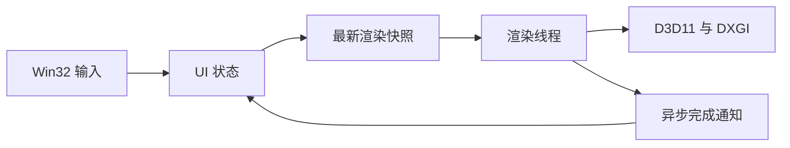

[English](../en/architecture.md) | [简体中文](architecture.md)

<!-- doc-id: architecture; revision: 17; status: fullscreen-review -->

# 架构与实现范围

Pixstride 面向 Windows 10/11 x64，采用 Rust Stable、Win32/windows-rs、D3D11 和 DXGI Flip Model。
阶段 A–C 已合并，阶段 C 静态 PNG 分块路径的六项 Windows 人工验收已由负责人确认通过。
D1-a GIF 静态首帧和 EXIF 5/7 修复也已合并，其他格式扩展仍属提案，
本页不复述早期内部设计草稿。

## 阶段 A 实现

UI 线程维护 `HWND`、消息循环、输入和当前视图状态。独立渲染线程创建并维护 D3D11 Device、
Immediate Context、DXGI Swap Chain、Shader 和纹理。这会让 D3D11 COM 接口留在线程内，
并将设备操作和 `Present` 移出消息处理过程。获得交互式延迟测量前，线程模型仍不能视为性能结论。

`Arc<Shared>` 通过一个 `Mutex<PendingState>` 保存最新渲染快照、重绘标志和关闭标志。UI 覆盖状态并触发
auto-reset event，不会将每次输入都排成渲染任务。渲染线程等待工作通知；有待绘制帧时，也等待 DXGI 帧延迟句柄。
没有待重绘内容时只等待工作，不轮询。COM 接口不会跨线程传递。Resize 和 Shutdown 期间，UI 继续处理消息，
不在窗口过程中 join 渲染线程。

窗口过程在 `WM_NCCREATE` 时把稳定的 `Box<WindowContext>` 指针存入 `GWLP_USERDATA`，并在 `WM_NCDESTROY`
时清除。渲染线程释放 D3D11 资源后触发 UI 持有的 completion event。UI 使用 `MsgWaitForMultipleObjects`
等待窗口消息或线程完成，join 渲染线程后再销毁窗口。线程入口捕获 panic；完成 guard 负责触发事件，若触发失败则
发送 `WM_QUIT` 作为后备。
Resize 和 `ResizeBuffers` 都在渲染线程执行；调用 `ResizeBuffers` 前清空 Immediate Context 并释放旧 Back Buffer
View。最小化形成零尺寸客户区时暂停绘制。

渲染器先尝试 Feature Level 11.1 或 11.0 的硬件 Device；Device 创建失败后再尝试 WARP。它使用双缓冲 Flip
Discard Swap Chain、最大帧延迟 1 和帧延迟等待对象，并调用 `Present(1, 0)`。程序在启动时生成两张
256 × 256 RGBA8 测试纹理，方向键只切换已有的 Shader Resource View。`build.rs` 用 Windows SDK 的 `fxc.exe`
编译 HLSL，并将 DXBC 嵌入程序。

`Present` 失败时，渲染器查询 `GetDeviceRemovedReason`，报告错误、释放资源并退出。阶段 A 不重建已移除的 Device。
Rust COM 包装器管理引用计数，但不保证 apartment、缓冲区和生命周期前置条件。UI 线程不共享 COM 对象，
也不能据此随意添加 `unsafe impl Send`。

| 阶段 A 验证项 | 当前证据与未完成工作 |
|---|---|
| 输入延迟 | 项目负责人测得输入状态发布 P50 为 3 µs，发布到渲染线程处理为 P50 168 µs、P99 2,352 µs、最大值 156,976 µs。样本未完全分类或受控；实际屏显时间仍未测量。 |
| 线程唤醒成本 | 当前版本按请求来源记录最新状态合并后的延迟。人工运行的汇总最大值为 156,976 µs；归因需要 WPR CPU Usage (Precise)。尚无与 UI 线程渲染方案的对照。 |
| Resize | 项目负责人已人工验证连续 Resize、最小化和恢复。零尺寸会跳过绘制，调用 `ResizeBuffers` 前释放旧 Render Target；跨 DPI 屏幕移动仍未测试。 |
| Shutdown | `WM_CLOSE` 发起异步关闭；UI 等待渲染线程完成并 join 后再销毁窗口。人工关闭测试已通过；自动竞争和 Device Lost 压力测试仍未完成。 |
| Device Removed | `Present` 失败后会查询 `GetDeviceRemovedReason` 并安全退出；尚未实现重建，也未注入设备移除故障。 |
| 资源同步 | Immediate Context 和 Swap Chain 由渲染线程维护；阶段 A 不含图片缓存或资源复用池。 |

## 阶段 B 图片处理路径

UI 线程维护当前 `Generation` 和目录选择。一个有界 MTA 工作线程独占 WIC、CPU LRU、目录扫描和相邻预加载。
线程通过 Channel 发送自有 BGRA8 缓冲区，WIC COM 接口不会跨线程传递。渲染线程独占 D3D11 Texture LRU，负责创建纹理和绘制。
另外一个有界身份线程校验源元数据，再交给渲染线程探测 GPU 缓存；命中绕过 WIC Worker，未命中才调度解码。
UI、身份、解码和渲染阶段使用同一选择 Generation 拒绝过期工作。负责人批准同方向长按进度显示：UI 在已有 Generation
区间内维护下界，渲染器只接受代际不倒退的已完成图片，不修改目标。松键、反向、失焦或打开文件时关闭区间，最新目标继续加载。
较新 GPU 命中禁止旧解码覆盖；没有降低输入频率、增加线程或引入无界请求队列。已提交 DXGI 的帧不能撤回。原始尺寸预算在
EXIF 前检查；Worker 按已校验的源修订最多保留 32 条预算拒绝，与像素缓存和暂时读取错误分开。实现范围和限制见[阶段 B 说明](stage-b.md)。

[D3D11 线程规则](https://learn.microsoft.com/en-us/windows/win32/direct3d11/overviews-direct3d-11-render-multi-thread-intro)
和 [Present 契约](https://learn.microsoft.com/en-us/windows/win32/api/dxgi/nf-dxgi-idxgiswapchain-present)
约束具体实现。Rust COM 包装器管理引用计数，不保证 apartment、缓冲区和生命周期前置条件正确。
原生文件对话框在 UI 线程运行；WIC COM 对象留在图片工作线程的 MTA，不传到 UI 或渲染线程。
本设计不能作为任意添加 `unsafe impl Send` 的依据。

当前实现采用双缓冲 Flip Discard 交换链、最大帧延迟 1 和按需渲染，包括首帧在内都先等待帧就绪。
闲置时等待工作通知，不轮询已处于有信号状态的帧句柄。
这些设置依据 [Flip Model 指南](https://learn.microsoft.com/en-us/windows/win32/direct3ddxgi/for-best-performance--use-dxgi-flip-model)
和[可等待对象契约](https://learn.microsoft.com/en-us/windows/win32/api/dxgi1_3/nf-dxgi1_3-idxgiswapchain2-getframelatencywaitableobject)，
实际延迟收益仍须在可交互的目标系统测量。

## 阶段 C 决策：有界行缓冲与视口分块

阶段 C 使用 `png 0.18.1`、原始 PBGRA8 磁盘 Tile、向上取整减半的金字塔和渲染线程 Tile Shader，建立独立静态 PNG
路径。普通图片保留阶段 B。行缓冲实验后，早期 512 MiB Builder 提案调整为 128 MiB，1024 仍属实验 Tile 边长。
Tile CPU/GPU 驻留预算分别为 64/128 MiB，独立于普通图片各 512 MiB 缓存；有界答复会额外持有暂存缓冲。
[阶段 C 说明](stage-c.md)记录测试、限制与测量。

一个延迟启动的后台线程负责构建或读取 Tile，不占用 WIC。一个最新构建请求、一个最新视口请求和两个答复限制排队工作。
已有源选择 Generation 和 Render Snapshot 序号拒绝过期工作。取消采用协作方式，阻塞读取可能超过两秒关闭宽限期，
但之后不能使用 HWND/GPU/UI 句柄。渲染器不读取 Tile 文件。

预览在完整构建后发布。每个可见区域绘制所选 Tile 或对应预览区域，保持 Alpha，避免重叠。带 CRC 的索引/数据记录与
原子目录发布拒绝未完成或损坏数据。源一致性使用元数据和三段抽样 CRC，不是完整或密码学身份。活动缓存句柄阻止淘汰，
根文件 lease 串行化构建和清理。没有引入缓存数据库、Worker Process、IPC、Job Object 或自动 Device Lost 恢复。

此方案优先保证清晰的所有权边界和可测量分配，以磁盘空间和首开完整预览等待为代价。磁盘写入性能、源抽样漏检、OS
缓存增长、磁盘耗尽、驱动阻塞及历史视口长尾归因仍需评审。负责人已验收真实桌面手势，不能据此认定长期稳定性或故障恢复通过。

## D1-b2 播放边界

已合并的 D1-b2 将 `ImageLoader` 的唯一惰性动画控制器移交 Render Thread；
WIC COM 与顺序合成仍由单个 MTA Worker 独占。Render Thread 管理播放时钟、一个未来 CPU 帧和一个复用的动画 Texture/SRV。
两个输出 Credit 仍覆盖排队、消费端持有和生产中的帧，没有第二个上传队列。

动画像素最多占共同 512 MiB CPU 账本中的 256 MiB。动画 GPU 载荷包括等待 Query 的退役资源，
最多占共同 512 MiB GPU 限制中的 128 MiB。静态 LRU 准入计入动画载荷，可淘汰未固定的条目。
这些是应用载荷限制，不能硬限制进程内存或驱动分配。Stage C 保持不变。

文件选择 Generation、Source Revision、Session ID 和 Frame Ordinal 分别验证。
Render Thread 等待工作、生产者输出、单次计时器或 DXGI 帧可用事件；DXGI 事件不充当 GPU 完成 Fence。
暂停、结束和静态空闲时，计时器移出等待集。UI 异步观察 Worker 完成，在 COM/数据清理后 join；
WIC 阻塞仍沿用有限关闭宽限与安全分离边界。策略、测量、自动化证据及负责人报告通过的八项 Windows 人工验收见 [D1-b2](stage-d1b2.md)。

## 已合并的 D3-a1 视口几何

`view_transform` 用 f64 将原图边界映射到客户区物理像素。普通图片和 Tile 选块共用 Fit/100%、
鼠标锚点、Pan 及 Resize 中心保持公式。普通路径复用既有 Tile Quad Shader，增加一个 32 字节常量缓冲；
Tile 的 LOD、边界像素、回退和预算仍由原模块管理。只改变视图不会改变 GPU 像素和动画截止时间。

Render Thread 在既有共享状态锁内确认已接受的 Generation 和最终尺寸，只在接受新选择时重置额外 Zoom/Pan。
GIF 换帧不确认新图片。输入仍在 UI 线程执行，不读取文件。坐标、资源边界及负责人报告通过的十项 Windows 人工验收见 [D3-a1](stage-d3a1.md)。

## D3-a2 UI 窗口事务

本地全屏模块在 WindowContext 内保存一份进入前的原生 Placement/样式快照。
F11/Esc 由 UI 线程处理，保留 Z 序，覆盖 rcMonitor，并恢复普通/最大化状态。
显式过渡及恢复待重试状态处理同步消息重入和回滚失败；显示器/DPI 变化采用当前物理矩形，
失效的普通窗口位置回退到可见工作区。只有真实客户区尺寸变化才进入既有 Render Snapshot。
ViewTransform 保持观察中心，GIF Session/Loop 及 GPU 资源继续由原组件维护。
没有 DXGI 独占全屏、新渲染循环或预算变化。Swap Chain Factory 显式禁止 DXGI 自动模式/Alt+Enter 处理，
原生窗口样式仍由 UI 维护。失败语义、实测及待人工验收见 [D3-a2](stage-d3a2.md)。

## 已完成阶段范围与延后工作

| 阶段 | 已实现范围或规划候选项 | 预留或延后 |
|---|---|---|
| A | Win32 生命周期、单一渲染维护线程、最新快照、按需使用的简单快照序号和设备代际、内嵌测试纹理、QPC 事件、尺寸变化/关闭/恢复测试。 | 不加入文件导航、解码池、CPU/GPU 图片缓存、IPC、Job Object、Color Cache 或分块调度器。 |
| B | 已合并 WIC JPEG/PNG/BMP 解码、检查过的像素布局、源身份、一个 WIC Worker 和一个源校验线程、CPU/GPU LRU 缓存、目录导航、相邻预加载和过期 Generation 丢弃；图形界面和快速导航复测已通过。 | 保持单个 WIC Worker、有界源校验和两个相邻预加载；通用优先级框架和纹理池待测量后再评估；已合并的 D3-a1 增加普通图片平移。 |
| C | 已合并超大 PNG 顺序流式处理、预览、磁盘 Tile Cache/Pyramid、可见区域渲染、缩放/平移和资源失败回归；负责人六项 GUI 验收通过。 | 渐进预览及全面 Device Lost、资源耗尽和稳定性验证仍未完成；工作进程 IPC 与 Job Object 隔离需有实测依据，暂不固定插件或 IPC ABI。 |
| D（部分完成） | EXIF 5/7 修复、GIF 静态首帧和后台生产已合并；D1-b2 播放已合并，通过自动化测试，负责人报告八项 Windows 人工验收全部通过。D3-a1 统一几何已通过 PR #10 合并，负责人报告十项 Windows 人工验收全部通过。D3-a2 功能分支增加无边框全屏和构建进度，自动化验证通过；负责人反馈已执行全屏场景正常，五项进度检查通过。未覆盖的显示器/DPI 场景仍未验证，PR 审核/合并待完成。 | 更多格式、基本 ICC、可配置输入及漫画阅读需单独批准；有可验证的颜色路径后再加派生颜色缓存，HDR 继续延后。 |

阶段 A–C 已完成，后续阶段 D 工作需单独批准。现有像素布局、取消、预算不足和解码能力边界不代表可以新增
额外运行时服务或计数器。每种新增代际编号都必须有唯一维护模块和独立的失效原因。

## 普通图片与超大图片

普通图片采用文件读取 → 解码 → GPU 上传 → 显示的流程。
图像键和设备代际都有效的 GPU 缓存命中应直接复用纹理，不重新读源文件、解码、扫描目录或上传像素。
文件或颜色策略变化属于有效的失效原因；只凭大小和时间等弱元数据，不能保证内容不变。

超大 PNG 使用独立路径。连续 IDAT 负载组成同一个压缩流，无法仅凭独立文件偏移定位任意矩形。
阶段 C 构建器逐行读取、生成较低分辨率并写出可独立读取的磁盘分块。
首次完整预览可能需要扫描整个图像数据流，依据见 [PNG 规范](https://www.w3.org/TR/png-3/)
和[压力测试计划](stress-testing.md)。

早期实验初值为逻辑边长 1024 的分块和 512 MiB 构建器预算。阶段 C 已比较 512、1024、2048，
目前使用 1024 和 128 MiB，具体实测限制见阶段 C 说明。
640 MiB 的工作进程上限属于另一项提案，不是已测得的工作集边界。
Job Object 用于资源和故障隔离，本身不提供完整安全沙箱。这些数值均未被证明最优。

D3D11 Feature Level 11.x 的 Texture2D 单边上限为 16384 像素。
这是 GPU 资源限制，不是文件格式或解码器限制；尺寸更小的分配仍可能失败。
依据见 [D3D11 资源限制](https://learn.microsoft.com/en-us/windows/desktop/direct3d11/overviews-direct3d-11-resources-limits)。
尺寸计算使用 checked 64-bit 运算，CPU、GPU 和磁盘分别预留预算。
资源不足时显示粗预览或明确报错，不能静默退回完整超大位图分配。
不同路径必须保持预乘 Alpha 和颜色域语义一致。

## 评审整改清单

| 编号 | 风险或整改要求 | 维护模块与门槛 |
|---|---|---|
| A-01 | 渲染线程唤醒可能增加长尾延迟，保留调整线程模型的可能。 | Rendering；阶段 A 计时报告。 |
| A-02 | Resize/Shutdown 可能与 DXGI 互等，或残留后缓冲区引用。 | UI/Rendering；压力测试、Debug Layer 和生命周期验证。 |
| A-03 | 帧延迟信号不代表 GPU 资源已完成使用。 | Rendering；专门验证在途资源和复用。 |
| B-01 | WIC 内部分配不透明，单次调用可能无法中断。 | Decoder；逐 codec 测峰值和取消，并保守路由。 |
| B-02 | 过期完成或文件替换可能选中错误像素。 | Core/Cache；反向导航、源变化和键测试。 |
| C-01 | 早期 512 MiB 提案已调整为 128 MiB Builder 预算，估计仍不覆盖未知进程、分配器及 OS 缓存开销。 | 超大图片路径；分别测自有分配、进程和 OS 缓存。 |
| C-02 | 分块写入、缓存有效性和滤镜边界增加复杂度。 | Disk Cache/Rendering；先用小型参考样本，再用私人压力样本。 |
| C-03 | IPC/Job Object 带来启动和恢复成本。 | 超大图片原型；用取消和故障实验说明隔离必要性。 |
| D-01 | 派生 Color Cache 可能重复转换，或与系统颜色管理冲突。 | 颜色处理路径；有 profile/ACM 测试后再实现。 |

原始设计和环境证据保持原样，保存在内部归档中。其中详细预算和复杂机制仍是提案。
此前的环境探针已完成编译并创建 WIC Factory 和 D3D11 硬件设备，未测试交换链、查看器或产品延迟。
Debug 设备创建返回 `0x887A002D`；安装 Graphics Tools 需先获授权，不能宣称 Debug Layer 已验证。
该探针没有产品性能成绩；后续阶段 A/B 实测另有记录。
