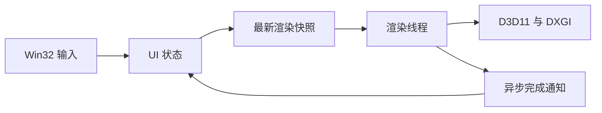

[English](../en/architecture.md) | [简体中文](architecture.md)

<!-- doc-id: architecture; revision: 1; status: proposal -->

# 架构范围与评审整改

Pixstride 已选定 Rust Stable、Win32/windows-rs、D3D11 和 DXGI Flip Model，
目标平台为 Windows 10/11 x64。本页说明下一步实验及其边界，属于提案，不代表已经实现，
也不完整翻译早期内部设计。

## 阶段 A：验证所有权和延迟

目前推荐由 UI 线程管理窗口和输入状态，由独立渲染线程管理 D3D11 即时上下文
（D3D11 Immediate Context）、DXGI 交换链和 GPU 资源。
这样可以将驱动阻塞和 `Present` 与输入处理隔离，代价是一次线程唤醒和显式生命周期协调。
阶段 A 的测量结果仍可能改变这一方案。

UI 发布不可变的[渲染快照（Render Snapshot）](../TERMINOLOGY.zh-CN.md)，并发出工作通知。
渲染线程等到可提交帧后再读取最新状态。等待尺寸变化和关闭的确认期间，UI 持续处理消息，
不能同步等待可能正在 `Present` 内的线程退出。图中尚未加入后续的解码和缓存服务。

| 阶段 A 必须验证的项目 | 证据与完成条件 |
|---|---|
| 输入延迟 | 分别记录输入接收、状态发布、渲染开始、`Present` 和对应的已显示事件。 |
| 线程唤醒成本 | 测量发布到渲染开始的时间，按足够样本报告 P50/P95/P99；必要时用有限的 UI 渲染实验对照。 |
| Resize 协作 | 合并尺寸变化，跳过零尺寸表面，在 `ResizeBuffers` 前释放所有后缓冲区引用；反复改变尺寸和 DPI 不出错。 |
| Shutdown | UI 持续处理消息，停止新提交，异步确认退出，释放资源且不形成相互等待。 |
| Device Lost | 注入可恢复错误，使旧设备代际的资源失效并重建设备路径；重复失败时报告错误，不无限重试。 |
| 资源同步 | 即时上下文和 DXGI 使用同一维护线程，限制待处理任务，验证在途资源不会过早复用。 |

[D3D11 线程规则](https://learn.microsoft.com/en-us/windows/win32/direct3d11/overviews-direct3d-11-render-multi-thread-intro)
和 [Present 契约](https://learn.microsoft.com/en-us/windows/win32/api/dxgi/nf-dxgi-idxgiswapchain-present)
约束具体实现。Rust COM 包装器管理引用计数，不保证 apartment、缓冲区和生命周期前置条件正确。
UI 的 COM 服务使用 STA；后续解码器 COM 对象留在各自的 MTA worker 中，跨 apartment 必须显式封送。
本设计不能作为任意添加 `unsafe impl Send` 的依据。

初始采用双缓冲 Flip Discard 交换链、最大帧延迟 1 和按需渲染，包括首帧在内都先等待帧就绪。
闲置时等待工作通知，不轮询已处于有信号状态的帧句柄。
这些设置依据 [Flip Model 指南](https://learn.microsoft.com/en-us/windows/win32/direct3ddxgi/for-best-performance--use-dxgi-flip-model)
和[可等待对象契约](https://learn.microsoft.com/en-us/windows/win32/api/dxgi1_3/nf-dxgi1_3-idxgiswapchain2-getframelatencywaitableobject)，
实际延迟收益仍须在目标系统测量。

## 控制第一阶段的范围

| 阶段 | 获准进入该阶段后实现 | 预留或延后 |
|---|---|---|
| A | Win32 生命周期、单一渲染维护线程、最新快照、按需使用的简单快照序号和设备代际、内嵌测试纹理、QPC 事件、尺寸变化/关闭/恢复测试。 | 不加入文件导航、解码池、CPU/GPU 图片缓存、IPC、Job Object、Color Cache 或分块调度器。 |
| B | 普通图片的 WIC 评估、像素与行跨度契约、源有效性、有界解码、CPU/GPU 缓存、导航和过期结果拒收。 | 从简单有界队列和在途任务表开始；通用优先级框架和纹理池等测量后再决定。 |
| C | 顺序解码大 PNG 的原型、预览、磁盘分块缓存、分块金字塔、可见区域渲染和资源不足测试。 | 扫描行解码和取消原型通过后，再评估工作进程 IPC 与 Job Object 隔离；暂不固定插件或 IPC ABI。 |
| D | 各格式能力、动画、基本 ICC、可配置输入和漫画阅读。 | 有可验证的颜色处理路径后再加入颜色键和派生缓存；HDR 和复杂滤镜仍属后续提案。 |

为 B/C 预留的接口只需说明像素布局、取消、预算不足和解码能力，不要求 A 先创建空运行时服务
或大量计数器。每种新增代际编号都必须有唯一维护模块和独立的失效原因。

## 普通图片与超大图片

普通图片采用文件读取 → 解码 → GPU 上传 → 显示的流程。
图像键和设备代际都有效的 GPU 缓存命中应直接复用纹理，不重新读源文件、解码、扫描目录或上传像素。
文件或颜色策略变化属于有效的失效原因；只凭大小和时间等弱元数据，不能保证内容不变。

超大 PNG 使用独立路径。连续 IDAT 负载组成同一个压缩流，无法仅凭独立文件偏移定位任意矩形。
计划中的构建器逐行读取、生成较低分辨率并写出可独立读取的磁盘分块。
首次完整预览可能需要扫描整个图像数据流，依据见 [PNG 规范](https://www.w3.org/TR/png-3/)
和[压力测试计划](stress-testing.md)。

实验初值为逻辑边长 1024 的分块和 512 MiB 构建器分配预算，需比较 512、1024、2048 三档。
640 MiB 的工作进程上限属于另一项提案，不是已测得的工作集边界。
Job Object 用于资源和故障隔离，本身不提供完整安全沙箱。这些数值均未被证明最优。

D3D11 Feature Level 11.x 的 Texture2D 单边上限为 16384 像素。
这是 GPU 资源限制，不是文件格式或解码器限制；尺寸更小的分配仍可能失败。
依据见 [D3D11 资源限制](https://learn.microsoft.com/en-us/windows/desktop/direct3d11/overviews-direct3d-11-resources-limits)。
尺寸计算使用 checked 64-bit 运算，CPU、GPU 和磁盘分别预留预算。
资源不足时显示粗预览或明确报错，不能静默退回完整超大位图分配。
不同路径必须保持预乘 Alpha 和颜色域语义一致。

## 评审整改清单

| 编号 | 风险或整改要求 | 维护模块与门槛 |
|---|---|---|
| A-01 | 渲染线程唤醒可能增加长尾延迟，保留调整线程模型的可能。 | Rendering；阶段 A 计时报告。 |
| A-02 | Resize/Shutdown 可能与 DXGI 互等，或残留后缓冲区引用。 | UI/Rendering；压力测试、Debug Layer 和生命周期验证。 |
| A-03 | 帧延迟信号不代表 GPU 资源已完成使用。 | Rendering；专门验证在途资源和复用。 |
| B-01 | WIC 内部分配不透明，单次调用可能无法中断。 | Decoder；逐 codec 测峰值和取消，并保守路由。 |
| B-02 | 过期完成或文件替换可能选中错误像素。 | Core/Cache；反向导航、源变化和键测试。 |
| C-01 | 512 MiB 估算没有覆盖未知的解码器和分配器额外开销。 | 超大图片原型；分别测自有分配、进程和 OS 缓存。 |
| C-02 | 分块写入、缓存有效性和滤镜边界增加复杂度。 | Disk Cache/Rendering；先用小型参考样本，再用私人压力样本。 |
| C-03 | IPC/Job Object 带来启动和恢复成本。 | 超大图片原型；用取消和故障实验说明隔离必要性。 |
| D-01 | 派生 Color Cache 可能重复转换，或与系统颜色管理冲突。 | 颜色处理路径；有 profile/ACM 测试后再实现。 |

原始设计和环境证据保持原样，保存在内部归档中。其中详细预算和复杂机制仍是提案。
此前的环境探针已完成编译并创建 WIC Factory 和 D3D11 硬件设备，未测试交换链、查看器或产品延迟。
Debug 设备创建返回 `0x887A002D`；安装 Graphics Tools 需先获授权，不能宣称 Debug Layer 已验证。
目前没有产品性能成绩。
