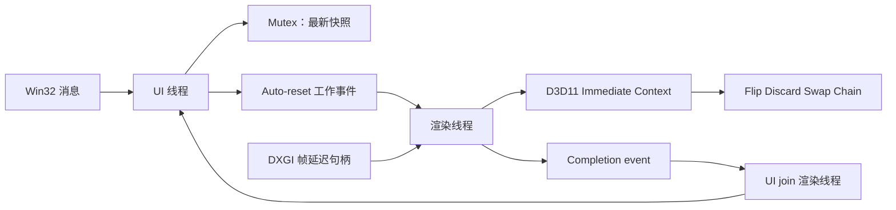

[English](../en/stage-a.md) | [简体中文](stage-a.md)

<!-- doc-id: stage-a; revision: 9; status: merged -->

# 阶段 A：Win32 窗口与 D3D11 渲染

阶段 A 已通过 [PR #2](https://github.com/pachi-qwq/pixstride/pull/2) 合并。本页保留第一个可运行切片的记录：
Win32 原生窗口、独立 D3D11 渲染线程和按需 DXGI 呈现。当时尚不读取图片文件或实现导航，相关能力已在
[阶段 B](stage-b.md) 合并，随后 [阶段 C](stage-c.md) 加入超大 PNG 支持。

## 线程职责与事件流

UI 线程创建并维护 `HWND`，处理 Win32 消息循环，更新最新渲染状态，并触发 Windows auto-reset event。
渲染线程创建并维护 D3D11 Device、Immediate Context、Swap Chain、Shader、Render Target、Sampler
和两张测试纹理。D3D11 COM 接口不会跨线程传递。渲染线程释放资源后，会触发由 UI 持有的
manual-reset completion event。UI 使用 `MsgWaitForMultipleObjects` 同时等待该事件和窗口消息，随后
join 渲染线程，再销毁 `HWND`。线程退出 guard 即使在捕获 panic 后也会通知完成；若 `SetEvent` 失败，
则向 UI 线程发送 `WM_QUIT` 作为后备。这避免依赖可能发送失败、而 UI 又在等待时收不到的窗口消息。



`Arc<Shared>` 通过 `Mutex<PendingState>` 在线程间共享少量状态，里面包括当前测试纹理、客户区尺寸、
序号、重绘标志和关闭标志。新状态会覆盖旧快照，不会逐个积累渲染任务，因此快速翻动输入不会形成无界队列。
auto-reset event 只负责唤醒渲染线程，不存储渲染状态。有待绘制帧时，渲染线程等待工作事件或 DXGI 帧延迟句柄；
没有待绘制帧时，只等待工作事件，不轮询。

窗口过程从 `GWLP_USERDATA` 读取稳定的 `Box<WindowContext>` 指针。UI 线程在 `WM_NCCREATE` 安装指针，
在 `WM_NCDESTROY` 清除。收到关闭请求后，UI 线程通知渲染线程并继续处理消息。渲染线程先清空
Immediate Context 并释放 Back Buffer View 等 COM 包装器，随后触发 completion event；UI join 线程后才销毁窗口。
如果 `SetEvent` 失败，线程 guard 会向 UI 线程发送 `WM_QUIT` 作为后备。
`ResizeBuffers` 也只在渲染线程执行，并且会先解除 Context 对旧 Back Buffer 的绑定、释放旧 Render Target View。
最小化时客户区尺寸为零，渲染暂停。

## D3D11 与呈现路径

程序先请求 Feature Level 11.1 或 11.0 的硬件 D3D11 Device。Device 创建失败时尝试 WARP；启动日志会记录
实际 Driver Type、Feature Level 和 DXGI Adapter 名称。后续 Swap Chain 或 Shader 创建失败时不会再次回退。
当前实现创建两个缓冲区的 `DXGI_SWAP_EFFECT_FLIP_DISCARD` Swap Chain，
启用 `DXGI_SWAP_CHAIN_FLAG_FRAME_LATENCY_WAITABLE_OBJECT`，将最大帧延迟设为 1，绘制前等待帧延迟句柄，
并调用 `Present(1, 0)`。

程序启动时在内存中生成两张 256 × 256 RGBA8 测试图：棋盘格和渐变图。每张图各创建一个 D3D11 Texture2D
和 Shader Resource View。按 Left 或 Right 只切换已有视图，不会重新生成或上传像素。全屏三角形通过线性
Sampler 采样所选纹理，窗口会把纹理拉伸至客户区大小。

`build.rs` 使用 Windows SDK 中的 `fxc.exe` 编译 `shaders/test_pattern.hlsl`，将 DXBC 字节码写入 Cargo
的 `OUT_DIR`，并嵌入可执行文件。程序正常启动或绘制帧时不会重复编译 Shader。如果自动发现 Windows SDK
目录失败，可将 `PIXSTRIDE_FXC` 设置为 `fxc.exe` 的完整路径。

如果 `Present` 失败，渲染器会查询 `GetDeviceRemovedReason`，报告错误并退出。阶段 A 尚未实现 Device 重建和恢复。
Rust COM 包装器会在渲染器于所属线程析构时释放引用。UI 线程不持有 D3D11 资源。

## 计时范围

程序使用 `std::time::Instant`。它在 Windows 上单调递增，并由系统高精度时钟提供支持。每项指标最多保留最近
4096 个样本，形成固定容量环形缓冲区；退出时输出样本数、最小值、最大值、P50、P95 和 P99，分位数使用最近秩法。
程序不会在每帧同步写日志。

| 指标 | 测量范围 |
|---|---|
| 启动 | 进程入口到 `CreateWindowExW` 返回；不代表窗口已可见或已合成显示。 |
| D3D11 初始化 | Device、Swap Chain、已编译 Shader、测试纹理上传和初始 Render Target 创建。 |
| Device 创建 | `D3D11CreateDevice` 耗时；若硬件创建失败，也包括 WARP 重试。 |
| Swap Chain 创建 | 创建 DXGI Swap Chain 并设置帧延迟的耗时。 |
| Shader 初始化 | 创建 Vertex Shader、Pixel Shader、Sampler 和 Rasterizer State 的耗时。 |
| 测试纹理准备 | CPU 生成测试像素、创建 D3D11 Texture2D 和 Shader Resource View 的耗时。该项测 CPU/API 路径，不等待 GPU 完成。 |
| 首次 Present | 从 Render Thread 启动到首个 `Present` 调用成功返回的耗时，包括初始化和首帧工作。 |
| 输入处理 | 方向键处理到发布最新状态并触发事件。 |
| 请求到渲染线程 | 发布快照的时间到渲染线程读取该快照。 |
| 渲染命令 | CPU 设置 D3D11 状态、清理 Render Target 并提交三角形绘制的时间。 |
| Present | `Present(1, 0)` 调用耗时，不代表画面显示耗时。 |
| Resize | 渲染线程调整缓冲区并重建 Render Target 的 CPU 耗时；零尺寸暂停不计入。 |
| 关闭 | UI 发出关闭请求到渲染线程退出；不包括所有 OS 进程清理。 |

这些计时无法证明画面何时到达显示器。可用 PresentMon/ETW 观察已显示帧事件；Input-to-Photon 还需外部高速
拍摄方法。当前程序没有集成这些工具。首次 Present 是应用内阶段记录，不是屏显时间；不能把 `Present` 快速返回解释成屏显延迟结果。

项目负责人在 Release 程序上完成了人工 GUI 验收：棋盘格正常显示，Left/Right 可以切换纹理，最大化、最小化、
恢复和连续 Resize 正常，Alt+F4 能退出并输出计时报告。测试机器使用 NVIDIA GeForce RTX 4080 SUPER、
Hardware Driver 和 Feature Level 11.1。这些是人工功能测试，不代表延迟或长期稳定性测试。

项目负责人一次诊断运行测得 D3D11 初始化 183.236 ms，其中 Device 创建为 177.742 ms。输入状态发布 P50 为
3 µs；状态发布到渲染线程处理 P50 为 168 µs、P99 为 2,352 µs、最大值为 156,976 µs。`Present(1, 0)` 调用
P50 为 226 µs，Resize P50 为 1,759 µs，关闭请求到渲染线程退出为 14,554 µs。该次运行未记录样本数和受控的
启动/缓存条件，因此这些数据是诊断观测值，不是受控性能结果。Present 耗时不表示像素何时到达显示器。

现有汇总数据无法判断 156,976 µs 长尾来自何处。新增指标按渲染线程实际读取的最新合并请求分类：初始尺寸、
键盘输入、Resize、最小化、恢复或 WM_PAINT。由于状态会合并，该分类只标记线程读取的快照，无法标记之前合并掉的
每个输入。要区分系统调度延迟与正在执行的 Present/驱动或 Resize 工作，需要在隔离的输入和 Resize 场景下，
采集并关联 Windows Performance Recorder 的 CPU Usage (Precise) 跟踪。旧的 156,976 µs 样本无法追溯分类。

此前两次本机 Release 启动记录的进程入口到 `CreateWindowExW` 返回时间分别为 2.824 ms 和 4.762 ms，
D3D11 初始化时间分别为 223.234 ms 和 206.379 ms。这只是同一台机器上的两次诊断样本，未控制冷/热启动条件，
不足以形成可靠的分位数报告。两次日志都记录首个 `Present` 调用成功返回。这些运行早于 Driver Type 和 Adapter 名称日志，
因此无法确认使用硬件驱动还是 WARP。这两次启动也不是受控的冷启动/热启动测量。

## 构建和运行

需要 Windows 10/11 x64、Rust Stable、`x86_64-pc-windows-msvc` Target、MSVC C++ Build Tools、
Windows SDK 和 `fxc.exe`。

```powershell
cargo fmt --all -- --check
cargo clippy --all-targets --locked -- -D warnings
cargo test --locked
cargo build --release --locked
cargo run --release
```

Release 可执行文件位于 `target/release/pixstride.exe`。关闭程序后，stdout 会输出计时汇总。Rust CI 在
`windows-latest` 上运行格式检查、Clippy、测试、Release 构建和 Rustdoc；它不运行交互式 GUI 测试，也没有修改
GitHub Ruleset 的必需检查。

## 验证状态

本地 Rust 验证已通过格式检查、禁止警告的 Clippy、单元测试、Release 构建和 Rustdoc 生成。
单元测试覆盖有界计时样本、分位数计算、测试纹理数据、最新状态合并和终止关闭状态。

项目负责人在 NVIDIA GeForce RTX 4080 SUPER、Hardware Driver、Feature Level 11.1 的桌面上人工确认：棋盘格可见、
方向键可切换纹理、最大化/最小化/恢复正常、连续 Resize 未卡死或黑屏，Alt+F4 正常退出并输出计时报告。
CI 验证编译和非 GUI 测试，不执行交互式窗口验收。

受控的冷启动和热启动统计、真实 Input-to-Photon 延迟、GPU Device Lost 压力测试和长期稳定性测试仍未完成。
现有数据不能证明线程模型达到 50 ms 启动、5 ms 缓存命中切换或 1 ms 输入处理目标；这些仍是工程目标，不是成绩。
